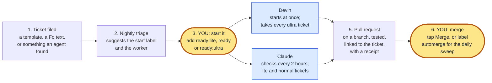

# Work queue — who taps what

**You start and merge. Agents do the rest.**

This page is a picture of [WORK.md](WORK.md), the rulebook. It adds no rule of its own: where the
two disagree, [WORK.md](WORK.md) wins and this page is wrong. `test/flow-doc.test.mjs` fails when
this page names a start label or a worker that [WORK.md](WORK.md) does not.

The two rounded, yellow steps (3 and 6) are a person's. Everything else is automation.

## Walk a ticket

- **lite**: You add `ready:lite`. Devin starts at once, or Claude at its next check. One small change, one pull request. You merge.
- **normal**: You add `ready`. Devin starts at once, or Claude at its next check. A change with a test, one pull request. You merge.
- **ultra**: You add `ready:ultra`. Always Devin. Cross-repo or risky work. If it cannot finish, the ticket goes to `blocked` and waits for you.

## Where each tap lives

- [Queue: tickets waiting for a start label](https://github.com/search?q=org%3Aaigovops-foundation+is%3Aissue+is%3Aopen+label%3Aqueue&type=issues)
- [Pull requests with green checks](https://github.com/search?q=org%3Aaigovops-foundation+is%3Apr+is%3Aopen+draft%3Afalse+status%3Asuccess&type=pullrequests)
- Automerge off switch: set `ESTATE_AUTOMERGE` to `off` in this repository's
  [repository variables](https://github.com/aigovops-foundation/aigovops/settings/variables/actions)
- The rulebook: [WORK.md](WORK.md)
